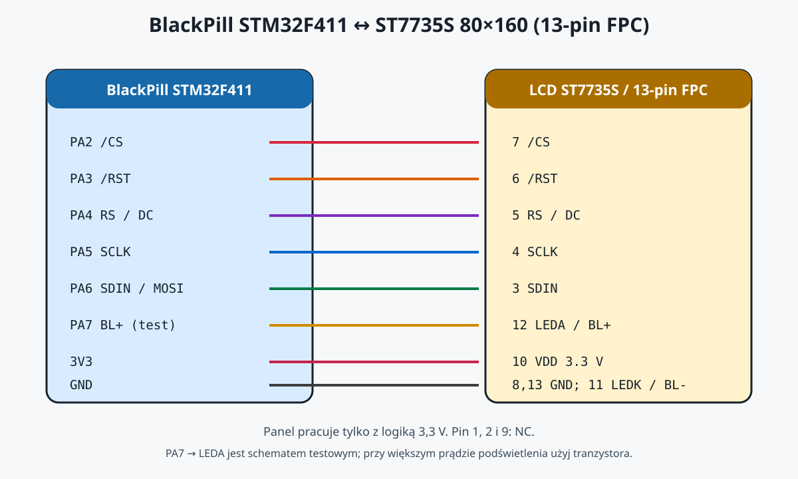

# Połączenie BlackPill STM32F411 z LCD ST7735S 80x160

## Sprawdzone połączenie programu

| BlackPill STM32F411 | LCD / sygnał | FPC FXD096QQ08B-F |
|---|---|---:|
| PA2 | `/CS` | 7 |
| PA3 | `/RST` | 6 |
| PA4 | `RS` / `DC` | 5 |
| PA5 | `SCLK` | 4 |
| PA6 | `SDIN` / `MOSI` | 3 |
| PA7 | `LEDA` / `BL+` | 12 |
| 3V3 | `VDD` | 10 |
| GND | `GND` | 8 i 13 |
| GND | `LEDK` / `BL-` | 11 |

Nie podłączaj żadnego pinu sygnałowego LCD do 5 V. Wspólna masa BlackPill i
LCD jest obowiązkowa.

## Uwaga o podświetleniu

Na stole działało bezpośrednie `PA7 -> LEDA`, co zapala podświetlenie.
To jest połączenie testowe: przed długą pracą zmierz prąd podświetlenia. Jeśli
jest większy niż bezpieczny prąd wyjścia STM32, użyj tranzystora i ograniczenia
prądu zamiast zasilać LED bezpośrednio z PA7.

## Nieużywane piny FPC

| Pin FPC | Opis |
|---:|---|
| 1 | TP0 / NC |
| 2 | TP1 / NC |
| 9 | NC |

Pinout FXD096QQ08B-F i użycie kontrolera ST7735S pochodzi z analizy
[Rip It Apart: Dispo Adventures](https://ripitapart.com/2024/04/20/dispo-adventures-episode-1-reverse-engineering-and-running-windows-95-on-a-disposable-vape-with-a-colour-lcd-screen/).
QSFX0961301 był sprawdzony na tym samym okablowaniu, lecz wymaga innego
`MADCTL` i `INVON`; wybiera się go przełącznikiem `LCD_PANEL` w kodzie.

## Zdjęcia z testu

- `photos/IMG_2049 2.JPG` — działający ekran BMS 13S.
- `photos/IMG_2051.JPG` — BlackPill i przewody testowe.
- `photos/IMG_2052.JPG` oraz `photos/IMG_2053.JPG` — połączenie modułu LCD.
- `photos/IMG_2054.JPG` — zbliżenie oznaczenia modułu QSFX.
